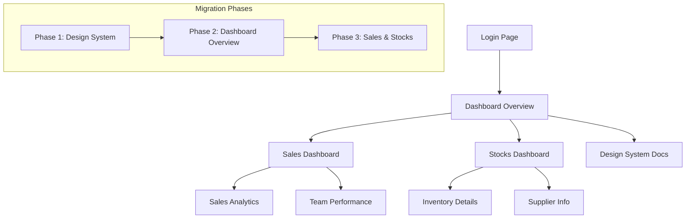

## 1. Product Overview

Rebuild the dashboard UI with a modern, scalable design system using shadcn/ui and Tailwind CSS. The new architecture will provide consistent user experience across Dashboard, Sales, and Stocks views while establishing a foundation for future development.

This rebuild addresses inconsistent UI patterns, improves developer productivity through reusable components, and ensures responsive design across all devices.

## 2. Core Features

### 2.1 User Roles

| Role | Registration Method | Core Permissions |
|------|---------------------|------------------|
| Admin User | Email registration with admin privileges | Full access to all dashboard features, user management, and system settings |
| Standard User | Email registration | Access to assigned dashboard modules (Dashboard, Sales, Stocks based on permissions) |
| Viewer User | Invitation-based access | Read-only access to dashboard data and reports |

### 2.2 Feature Module

The dashboard UI rebuild consists of the following main pages:

1. **Dashboard Overview**: main metrics display, quick stats cards, charts and graphs, recent activity feed
2. **Sales Dashboard**: sales metrics, revenue charts, customer analytics, sales team performance
3. **Stocks Dashboard**: inventory overview, stock levels, supplier information, reorder alerts
4. **Design System Documentation**: component showcase, design tokens reference, usage guidelines

### 2.3 Page Details

| Page Name | Module Name | Feature description |
|-----------|-------------|---------------------|
| Dashboard Overview | Metrics Cards | Display KPI cards with real-time data updates, trend indicators, and comparison metrics |
| Dashboard Overview | Charts Section | Interactive charts for revenue, user growth, and performance metrics with filtering options |
| Dashboard Overview | Activity Feed | Show recent system activities, user actions, and important notifications |
| Sales Dashboard | Sales Metrics | Display total revenue, conversion rates, average order value, and sales targets |
| Sales Dashboard | Customer Analytics | Show customer demographics, acquisition channels, and retention metrics |
| Sales Dashboard | Team Performance | Individual and team sales performance with leaderboards and achievement tracking |
| Stocks Dashboard | Inventory Overview | Real-time stock levels, warehouse locations, and inventory value calculations |
| Stocks Dashboard | Supplier Management | Supplier contact information, delivery schedules, and performance ratings |
| Stocks Dashboard | Reorder System | Automated low-stock alerts, reorder suggestions, and purchase order management |
| Design System | Component Library | Visual showcase of all UI components with code examples and usage guidelines |
| Design System | Design Tokens | Reference for colors, typography, spacing, and other design constants |
| Design System | Layout Templates | Pre-built page templates for consistent structure and responsive behavior |

## 3. Core Process

### User Navigation Flow
Users navigate through the dashboard using a persistent sidebar navigation that provides quick access to all major sections. The main flow starts from the Dashboard Overview, where users can drill down into specific areas like Sales or Stocks based on their role permissions.

### Migration Process Flow
The migration will be executed in phases to minimize disruption. Phase 1 focuses on establishing the design system and core components. Phase 2 migrates the Dashboard Overview page. Phase 3 handles Sales and Stocks views. Each phase includes thorough testing and rollback procedures.

## 4. User Interface Design

### 4.1 Design Style

**Color Palette:**
- Primary: #0F172A (slate-900) for headers and primary actions
- Secondary: #3B82F6 (blue-500) for interactive elements
- Accent: #10B981 (emerald-500) for success states
- Background: #F8FAFC (slate-50) for main background
- Surface: #FFFFFF for cards and elevated elements

**Typography:**
- Font Family: Inter for all text elements
- Heading Sizes: text-4xl (36px), text-3xl (30px), text-2xl (24px), text-xl (20px)
- Body Text: text-base (16px) for primary content, text-sm (14px) for secondary content
- Line Heights: Leading-tight for headings, leading-normal for body text

**Component Styling:**
- Buttons: Rounded corners (rounded-lg), consistent padding (px-4 py-2), hover states with opacity changes
- Cards: Subtle shadows (shadow-sm), rounded corners (rounded-lg), consistent spacing (p-6)
- Forms: Clean borders (border-gray-200), focus states with ring utilities, consistent spacing

**Layout System:**
- Grid: 12-column responsive grid with consistent gutters (gap-6)
- Container: Max-width of 1280px with responsive padding
- Sidebar: Fixed width of 280px, collapsible on mobile devices

### 4.2 Page Design Overview

| Page Name | Module Name | UI Elements |
|-----------|-------------|-------------|
| Dashboard Overview | Metrics Cards | Grid layout with 2-4 cards per row, colored backgrounds based on metric type, icon indicators for trends |
| Dashboard Overview | Charts Section | Responsive chart containers, legend positioning, interactive tooltips, consistent color schemes |
| Sales Dashboard | Sales Metrics | Card-based layout with progress indicators, comparison badges, and sparkline charts |
| Stocks Dashboard | Inventory Table | Sortable columns, status badges, inline editing capabilities, pagination controls |
| All Pages | Navigation Sidebar | Collapsible sidebar with icon + text navigation, active state highlighting, user profile section |
| All Pages | Header Bar | Breadcrumb navigation, user menu, notification bell, search functionality |

### 4.3 Responsiveness

The dashboard will be built with a desktop-first approach that gracefully adapts to mobile devices. Key responsive features include:

- **Sidebar**: Collapses to icons-only on tablets, transforms to bottom navigation on mobile
- **Grid Layout**: Adjusts from 12-column on desktop to 1-column on mobile
- **Cards**: Stack vertically on mobile, maintain multi-column layout on desktop
- **Tables**: Convert to card-based layouts on mobile with horizontal scrolling option
- **Charts**: Maintain readability with responsive sizing and touch-friendly interactions
- **Typography**: Scale appropriately with responsive text utilities

All breakpoints follow Tailwind's default scale: sm (640px), md (768px), lg (1024px), xl (1280px), 2xl (1536px).