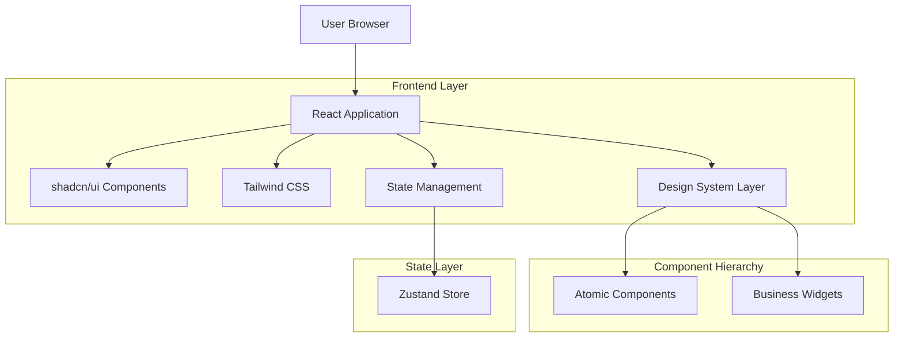

## 1. Architecture Design



## 2. Technology Description

**Frontend Stack:**
- React@18.2.0 - Component-based UI framework
- TypeScript@5.0.0 - Type safety and developer experience
- Vite@4.4.0 - Build tool and development server
- Tailwind CSS@3.3.0 - Utility-first CSS framework
- shadcn/ui@latest - Accessible, customizable component library
- Radix UI@latest - Headless UI primitives
- Zustand@4.4.0 - Lightweight state management
- React Router@6.15.0 - Client-side routing
- Recharts@2.8.0 - Chart library for data visualization

**Development Tools:**
- ESLint@8.45.0 - Code linting
- Prettier@3.0.0 - Code formatting
- Storybook@7.4.0 - Component documentation and testing

## 3. Route Definitions

| Route | Purpose | Component |
|-------|---------|-----------|
| / | Dashboard Overview | DashboardOverview.tsx |
| /sales | Sales Dashboard | SalesDashboard.tsx |
| /stocks | Stocks Dashboard | StocksDashboard.tsx |
| /design-system | Design System Docs | DesignSystem.tsx |
| /design-system/components | Component Showcase | ComponentShowcase.tsx |
| /design-system/tokens | Design Tokens Reference | DesignTokens.tsx |
| /design-system/templates | Layout Templates | LayoutTemplates.tsx |
| /migration-guide | Migration Documentation | MigrationGuide.tsx |

## 4. Component Architecture

### 4.1 Atomic Components (shadcn/ui based)
```typescript
// Button component with design system integration
interface ButtonProps {
  variant: 'primary' | 'secondary' | 'outline' | 'ghost';
  size: 'sm' | 'md' | 'lg';
  children: React.ReactNode;
  onClick?: () => void;
  disabled?: boolean;
  loading?: boolean;
}

// Card component with consistent styling
interface CardProps {
  title?: string;
  description?: string;
  children: React.ReactNode;
  className?: string;
  padding?: 'none' | 'sm' | 'md' | 'lg';
}

// Input component with validation states
interface InputProps {
  type: 'text' | 'email' | 'password' | 'number';
  placeholder?: string;
  value: string;
  onChange: (value: string) => void;
  error?: string;
  label?: string;
  required?: boolean;
}
```

### 4.2 Business Widget Components
```typescript
// Metrics Card for dashboard KPIs
interface MetricsCardProps {
  title: string;
  value: string | number;
  change?: number;
  changeType?: 'increase' | 'decrease';
  icon?: React.ComponentType;
  trend?: 'up' | 'down' | 'stable';
}

// Chart Widget for data visualization
interface ChartWidgetProps {
  title: string;
  data: ChartData[];
  type: 'line' | 'bar' | 'area' | 'pie';
  height?: number;
  showLegend?: boolean;
  interactive?: boolean;
}

// Data Table for inventory and sales
interface DataTableProps<T> {
  data: T[];
  columns: ColumnDef<T>[];
  searchable?: boolean;
  sortable?: boolean;
  filterable?: boolean;
  pagination?: boolean;
  onRowClick?: (row: T) => void;
}
```

## 5. Design System Implementation

### 5.1 Design Tokens Structure
```typescript
// colors.ts
export const colors = {
  primary: {
    50: '#f0f9ff',
    500: '#3b82f6',
    900: '#0f172a',
  },
  secondary: {
    50: '#f8fafc',
    500: '#64748b',
    900: '#0f172a',
  },
  accent: {
    success: '#10b981',
    warning: '#f59e0b',
    error: '#ef4444',
  }
};

// typography.ts
export const typography = {
  fontFamily: {
    sans: ['Inter', 'system-ui', 'sans-serif'],
    mono: ['JetBrains Mono', 'monospace'],
  },
  fontSize: {
    xs: '0.75rem',
    sm: '0.875rem',
    base: '1rem',
    lg: '1.125rem',
    xl: '1.25rem',
    '2xl': '1.5rem',
    '3xl': '1.875rem',
    '4xl': '2.25rem',
  },
  lineHeight: {
    tight: 1.25,
    normal: 1.5,
    relaxed: 1.75,
  }
};

// spacing.ts
export const spacing = {
  scale: {
    0: '0',
    1: '0.25rem',
    2: '0.5rem',
    3: '0.75rem',
    4: '1rem',
    5: '1.25rem',
    6: '1.5rem',
    8: '2rem',
    10: '2.5rem',
    12: '3rem',
    16: '4rem',
    20: '5rem',
    24: '6rem',
  }
};
```

### 5.2 Layout System
```typescript
// Layout components with responsive behavior
interface LayoutProps {
  children: React.ReactNode;
  sidebar?: React.ReactNode;
  header?: React.ReactNode;
  className?: string;
}

// Grid system with consistent spacing
interface GridProps {
  cols?: 1 | 2 | 3 | 4 | 6 | 12;
  gap?: 'sm' | 'md' | 'lg' | 'xl';
  responsive?: boolean;
  children: React.ReactNode;
}
```

## 6. Migration Strategy

### 6.1 Migration Phases

**Phase 1: Foundation (Week 1-2)**
- Set up design system with Tailwind CSS and shadcn/ui
- Create atomic components library
- Establish design tokens and CSS variables
- Build layout system and responsive grid

**Phase 2: Core Pages (Week 3-4)**
- Migrate Dashboard Overview page
- Implement new navigation and header components
- Create business widget components (MetricsCard, ChartWidget)
- Set up state management with Zustand

**Phase 3: Feature Pages (Week 5-6)**
- Migrate Sales Dashboard with new components
- Migrate Stocks Dashboard with data table improvements
- Implement responsive behavior across all breakpoints
- Add loading states and error handling

**Phase 4: Polish & Documentation (Week 7)**
- Create Design System documentation page
- Add Storybook stories for all components
- Performance optimization and code splitting
- Final testing and bug fixes

### 6.2 Migration Tools & Scripts

```bash
# Automated migration script for component conversion
npm run migrate:component -- --from=OldCard --to=NewCard

# Design system validation
npm run validate:design-system

# Responsive testing
npm run test:responsive
```

### 6.3 Rollback Strategy

Each migration phase includes:
- Feature flags for gradual rollout
- Backup of existing components
- A/B testing capability
- Quick rollback procedures
- Performance monitoring

## 7. State Management Architecture

```typescript
// Zustand store structure
interface DashboardStore {
  // UI state
  sidebarCollapsed: boolean;
  theme: 'light' | 'dark';
  
  // Data state
  metrics: MetricsData;
  charts: ChartData[];
  tables: TableData[];
  
  // Methods
  toggleSidebar: () => void;
  setTheme: (theme: 'light' | 'dark') => void;
  updateMetrics: (metrics: MetricsData) => void;
  updateCharts: (charts: ChartData[]) => void;
}
```

## 8. Responsive Design Implementation

### 8.1 Breakpoint System
- **Mobile**: < 640px (sidebar becomes bottom navigation)
- **Tablet**: 640px - 1024px (collapsible sidebar)
- **Desktop**: > 1024px (full sidebar, multi-column layouts)

### 8.2 Component Responsive Behavior
```typescript
// Responsive utility hooks
const useResponsive = () => {
  const [isMobile, setIsMobile] = useState(false);
  const [isTablet, setIsTablet] = useState(false);
  const [isDesktop, setIsDesktop] = useState(false);
  
  // Implementation details...
  
  return { isMobile, isTablet, isDesktop };
};
```

## 9. Performance Considerations

- **Code Splitting**: Route-based and component-based code splitting
- **Lazy Loading**: Components loaded on-demand
- **Image Optimization**: WebP format with responsive images
- **CSS Optimization**: PurgeCSS for unused styles removal
- **Bundle Size**: Monitor and optimize bundle size with webpack-bundle-analyzer